<h1 align = "center"> ASYNCHRONOUS FIFO </h1>

## 1. PROJECT OVERVIEW:
This project implements an Asynchronous First-In, First-Out (FIFO) buffer using Verilog HDL. An Asynchronous FIFO is a data buffer in which data items are retrieved in the exact order in which they were stored. The term **"Asynchronous"** means that the write and read operations are controlled by two independent clock signals. The **Write** operation depends on the write clock and write reset signals, whereas the **Read** operation depends on the read clock and read reset signals.

## 2. DESIGN SPECIFICATION:
| **Parameter** | **Description** |
|---|---|
| Data Width | 8 bits |
| FIFO Depth | 8 entries |
| Clock | Independent Write and Read clock |
| Status Flags | Full, Empty |
| Sub Modules | Read domain, Write domain, Synchronizer |
| CDC Technique | Pointer Synchronization
| Verification | Verilog testbench |
| Simulation Tools | Icarus Verilog, GTKWave |

## 3. ARCHITECTURE:
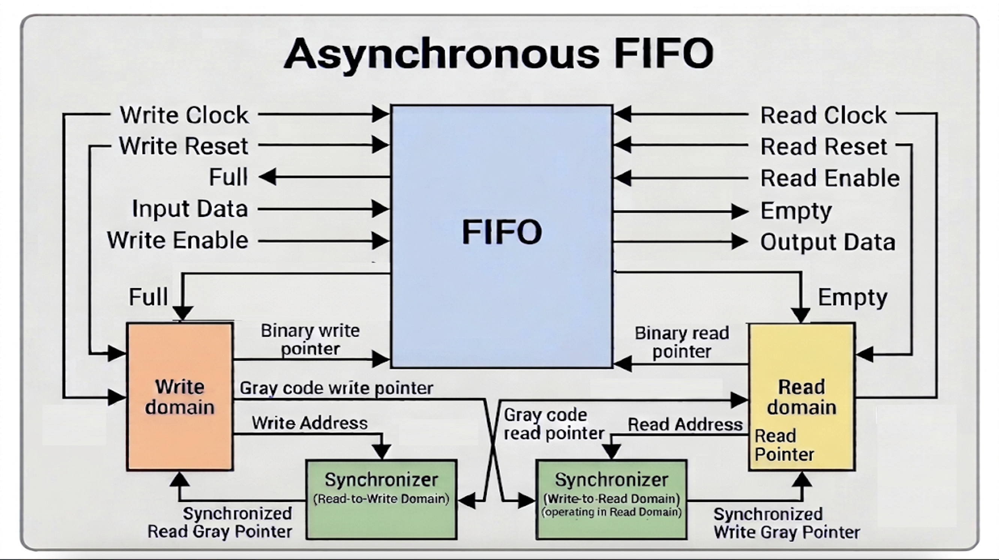

### Signal Description:
- **Top-Level Module (Asynchronous FIFO)**:
   + **Input:** Write Clock(1 bit), Read Clock(1 bit), Write Reset(1 bit), Read Reset(1 bit), Input Data(8 bits), Write Enable(1 bit), Read Enable(1 bit)
   + **Output:** Empty(1 bit - Status Flag), Full(1 bit - Status Flag), Output Data(8 bits)  

- **Write Domain:**
  + **Input:** Write Clock(1 bit), Write Reset(1 bit), Write Enable(1 bit), Full(1 bit - Status Flag)
  + **Output:** Binary write pointer(4 bits), Gray code write pointer(4 bits), Write Address(3 bits)

- **Read Domain:**
  + **Input:** Read Clock(1 bit), Read Reset(1 bit), Read Enable(1 bit), Empty(1 bit - Status Flag)
  + **Output:** Binary read pointer(4 bits), Gray code read pointer(4 bits), Read Address(3 bits)

- **Synchronizer:**
  + **Input:** Clock(1 bit), Reset(1 bit), Gray code pointer(4 bits)
  + **Output:** Synchronized Gray code pointer(4 bits)

## 4. MODULE DESCRIPTION:
- **Write Domain:**
  + When **Write Enable** is high (and the FIFO is not full), the binary write pointer is incremented by one and converted into Gray Code
  + The Gray-code write pointer is transferred to the read clock domain through the **Synchronizer**
  + The synchronizer uses the read clock and read reset to generate the synchronized Gray-code write pointer
  + The input data is written into the FIFO when the write operation is valid

- **Read Domain:**
  + When **Read Enable** is high (and the FIFO is not empty), the binary read pointer is incremented by one and converted into Gray Code
  + The Gray-code read pointer is transferred to the write clock domain through the Synchronizer
  + The synchronizer uses the write clock and write reset to generate the synchronized Gray-code read pointer
  + The data is read from the FIFO memory when the read operation is valid

- **Synchronizer:**
  + Each synchronizer consists of two **cascaded D Flip-Flops**
  + The synchronizer transfers Gray-code pointers between the independent clock domains
  + It helps reduce the probability of **metastability** propagating into the destination clock domain
  + The use of two flip-flops improves the **Mean Time Between Failures (MTBF)** by providing additional time for metastability to resolve.

## 5. FUNCTIONAL DESCRIPTION:
- **Temporary Storage:** The FIFO acts as a sequential buffer to hold data temporarily
- **Write Operation:** When **Write Enable** is high (and the FIFO is not full), the input data is written into the memory array and the write pointer is incremented by one
- **Read Operation:** When **Read Enable** is high (and the FIFO is not empty), data is read from the memory array to the output and the read pointer is incremented by one
- **Status Flags:** 
  - `Empty` goes high when no data is available, blocking read operations to prevent underflow
  - `Full` goes high when maximum capacity is reached, blocking write operations to prevent overflow
- **Clock Synchronization:**  The write and read operations are controlled by independent clocks. Gray-code pointers are synchronized between the two clock domains using two-stage synchronizers, allowing the FIFO to generate the Full and Empty status flags safely.


## 6. VERIFICATION AND TEST CASES:
| TC No. | Test Case |
|---|---|
| TC1 | Reset |
| TC2 | Pointer wraparound |
| TC3 | Write 8 words to the FIFO |
| TC4 | Attempt a write when full |
| TC5 | Read 8 words from the FIFO |
| TC6 | Attempt a read when empty |
| TC7 | Single byte write and read |
| TC8 | Multiple writes and reads |
| TC9 | Reset while FIFO contains data |
| TC10 | Different clock frequencies |

## 7. SIMULATION RESULTS:
### TC1 - Reset : <span style="color:green">PASS</span>
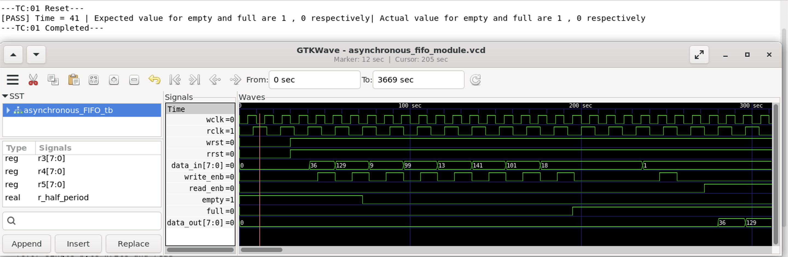
### TC2 - Pointer wraparound : <span style="color:green">PASS</span>
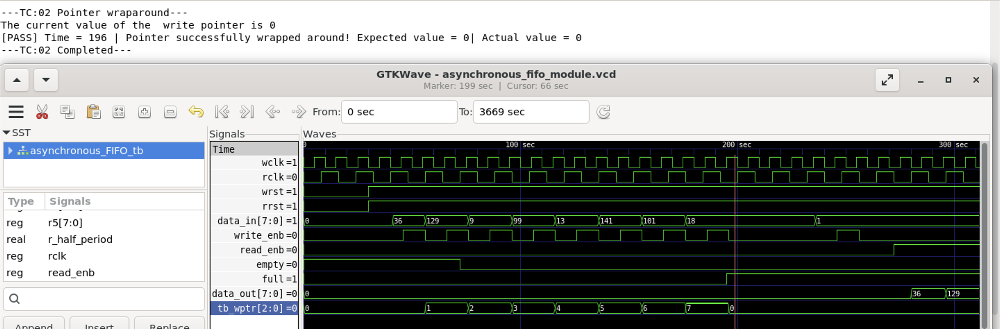
### TC3 - Write 8 words to the FIFO : <span style="color:green">PASS</span>
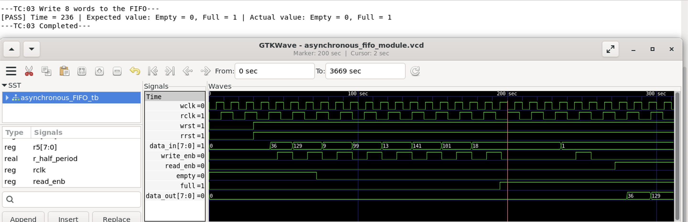
### TC4 - Attempt a write when full : <span style="color:green">PASS</span>

### TC5 - Read 8 words from the FIFO : <span style="color:green">PASS</span>
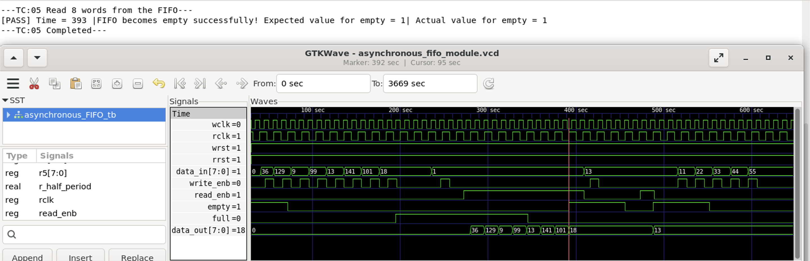
### TC6 - Attempt a read when empty : <span style="color:green">PASS</span>
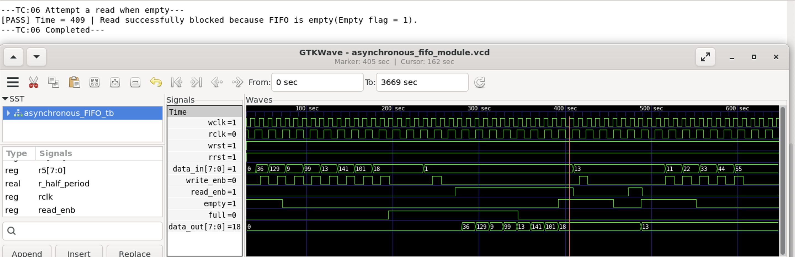
### TC7 - Single byte write and read : <span style="color:green">PASS</span>
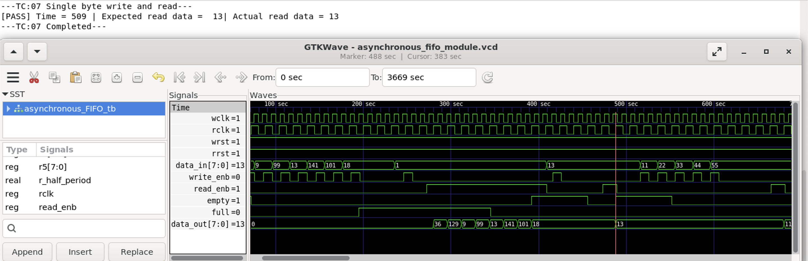
### TC8 - Multiple writes and reads : <span style="color:green">PASS</span>
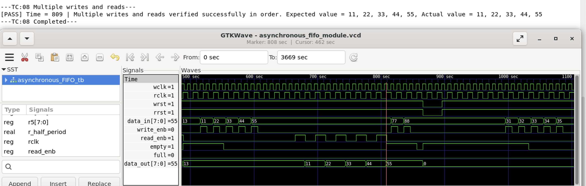
### TC9 - Reset while FIFO contains data : <span style="color:green">PASS</span>
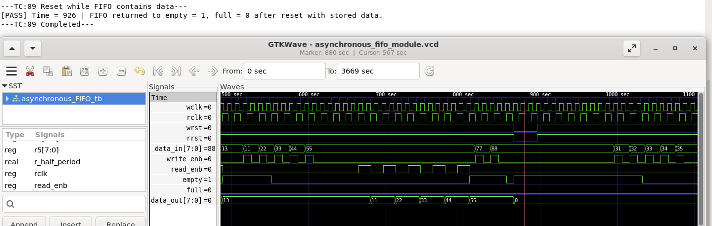
### TC10 - Different clock frequencies : <span style="color:green">PASS</span>
- Write clock **faster** then Read clock
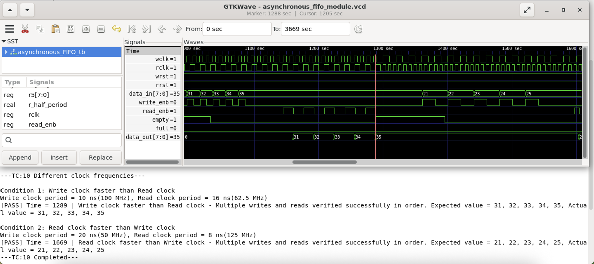
- Read clock **faster** then Write clock
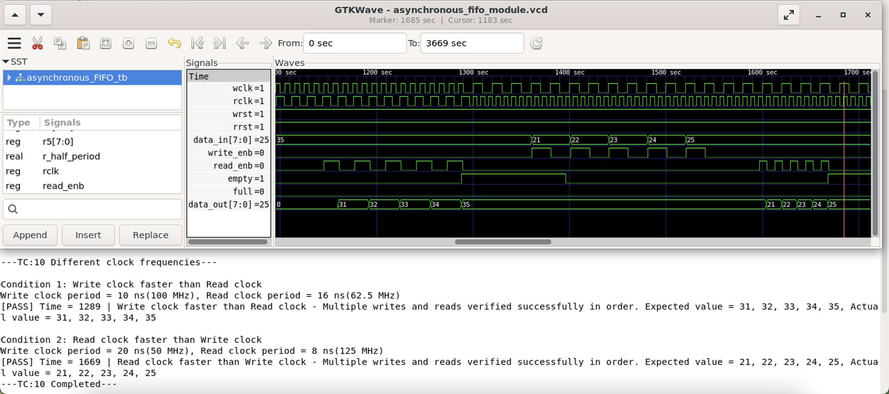

The below images depict the overall output and waveform generated after running the testbench for Asynchronous FIFO module.
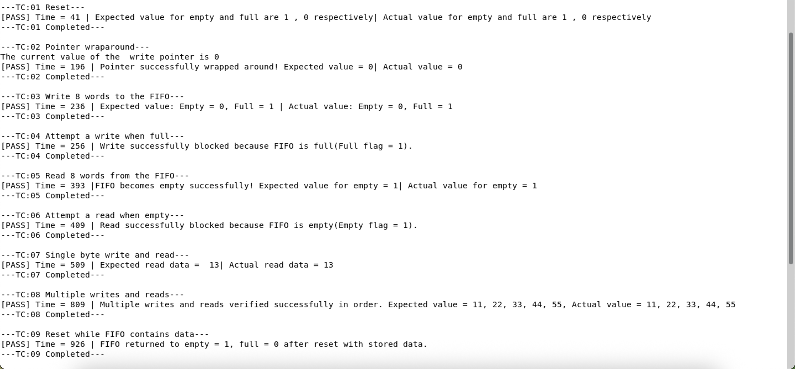
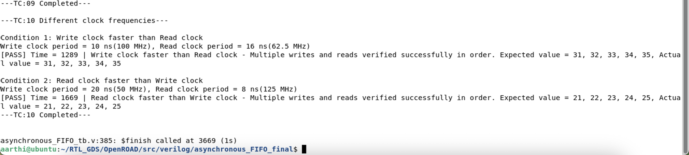
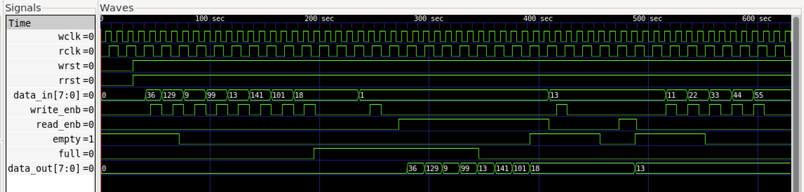
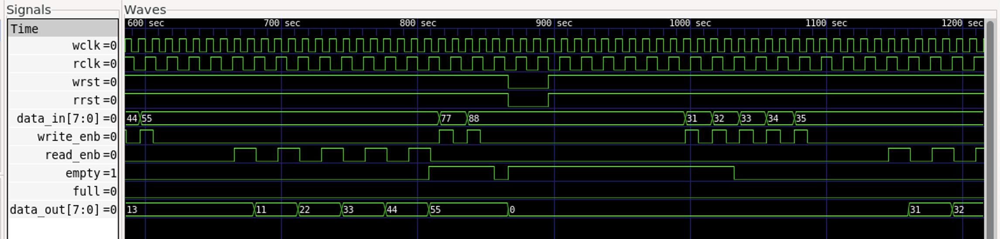
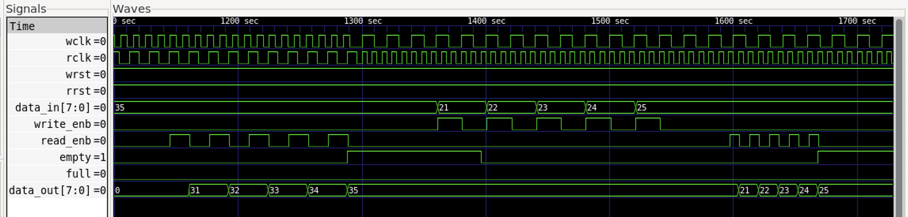

## 8. REPOSITORY STRUCTURE:
``` text
Asynchronous_FIFO/
├── rtl/
|    └── asynchronous_FIFO_top.v
     └── write_domain.v
     └── read_domain.v
     └── synchronizer.v
├── testbench/
|    └── asynchronous_FIFO_tb.v
├── README.md
├── Images/ 
├── Output/ 
└── Waveform/
```
## 9. KEY LEARNINGS:
- Clock domain crossing fundamentals
- Independent clock-domain control logic
- Pointer synchronization
- Two-stage D Flip-Flop synchronizer design
- Metastability and Mean Time Between Failures (MTBF)
---
