<h1 align = "center"> RANDOM ACCESS MEMORY(RAM) </h1>

## 1. PROJECT OVERVIEW:
This project implements a RAM module using Verilog HDL. RAM (Random Access Memory) allows data to be read from or written to any addressable memory location, with access to a specific location determined by the address input during operation.

## 2. DESIGN SPECIFICATION:
| **Parameter** | **Description** |
|---|---|
| Data Width | 8 bits |
| Memory Depth | 8 entries |
| Clock | Single clock |
| Verification | Verilog testbench |
| Simulation Tools | Icarus Verilog, GTKWave |

## 3. ARCHITECTURE:
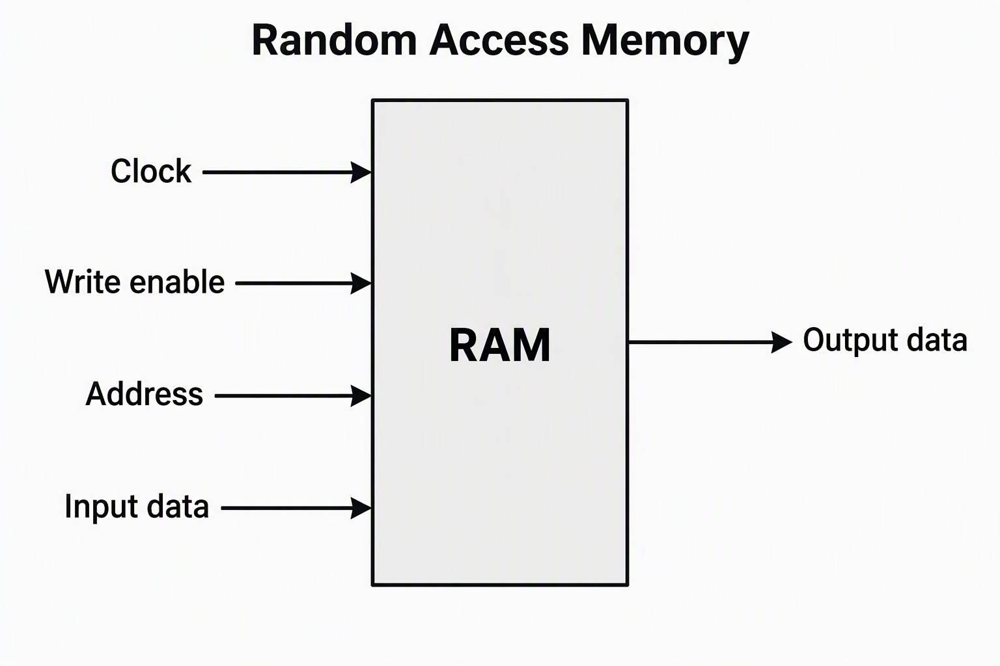
### Signal Description:
- **Input:** Clock(1 bit),  Write Enable(1 bit), Address(3 bits), Input Data(8 bits)
- **Output:** Output Data(8 bits)  

## 4. FUNCTIONAL DESCRIPTION:
- **Temporary Storage:** The RAM acts as a volatile memory to hold data temporarily
- **Write Operation:** When **Write Enable** is high, the input data is written into the memory array in the given address
- **Read Operation:** When **Write Enable** is low , data is read from the memory array to the output from the given address
- **Clock Synchronization:** Both read and write operations are fully synchronized to a single clock signal

## 5. VERIFICATION AND TEST CASES:
| TC No. | Test Case |
|---|---|
| TC1 | Basic write and read |
| TC2 | Multiple address access |
| TC3 | Overwrite existing data |
| TC4 | Data integrity check |
| TC5 | Data retention |
| TC6 | Read from an unwritten address |
| TC7 | Address boundary testing |
| TC8 | Back-to-Back Burst Write & Read Pipeline |

## 6. SIMULATION RESULTS:
### TC1 - Basic write and read : <span style="color:green">PASS</span>
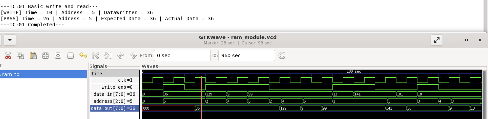
### TC2 - Multiple address access : <span style="color:green">PASS</span>
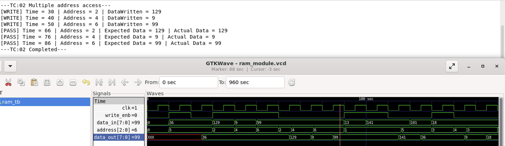
### TC3 - Overwrite existing data : <span style="color:green">PASS</span>
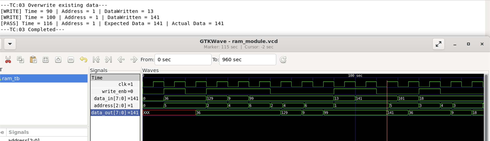
### TC4 - Data integrity check : <span style="color:green">PASS</span>

### TC5 - Data retention : <span style="color:green">PASS</span>
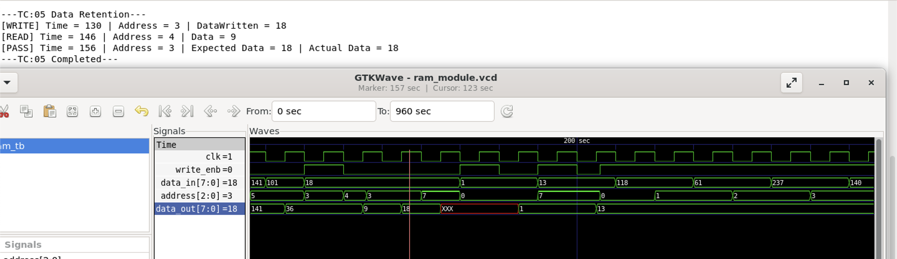
### TC6 - Read from an unwritten address : <span style="color:green">PASS</span>
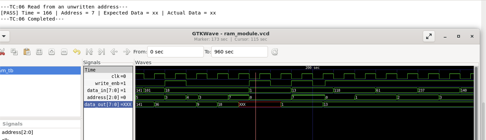
### TC7 - Address boundary testing : <span style="color:green">PASS</span>
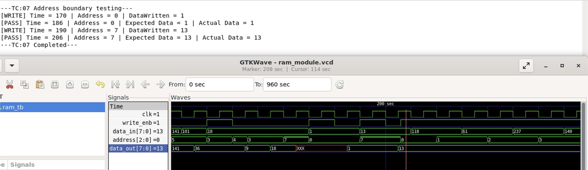
### TC8 - Back-to-Back Burst Write & Read Pipeline : <span style="color:green">PASS</span>
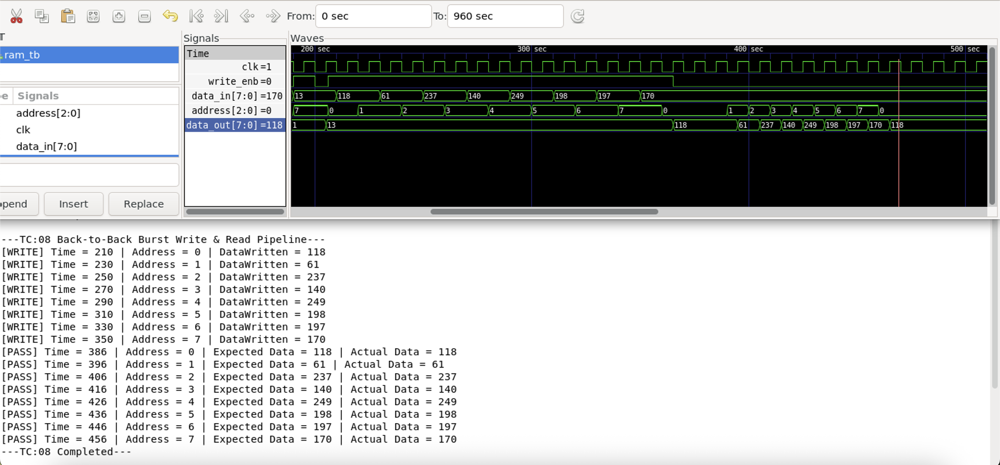

The below images depict the overall output and waveform generated after running the testbench for RAM module.
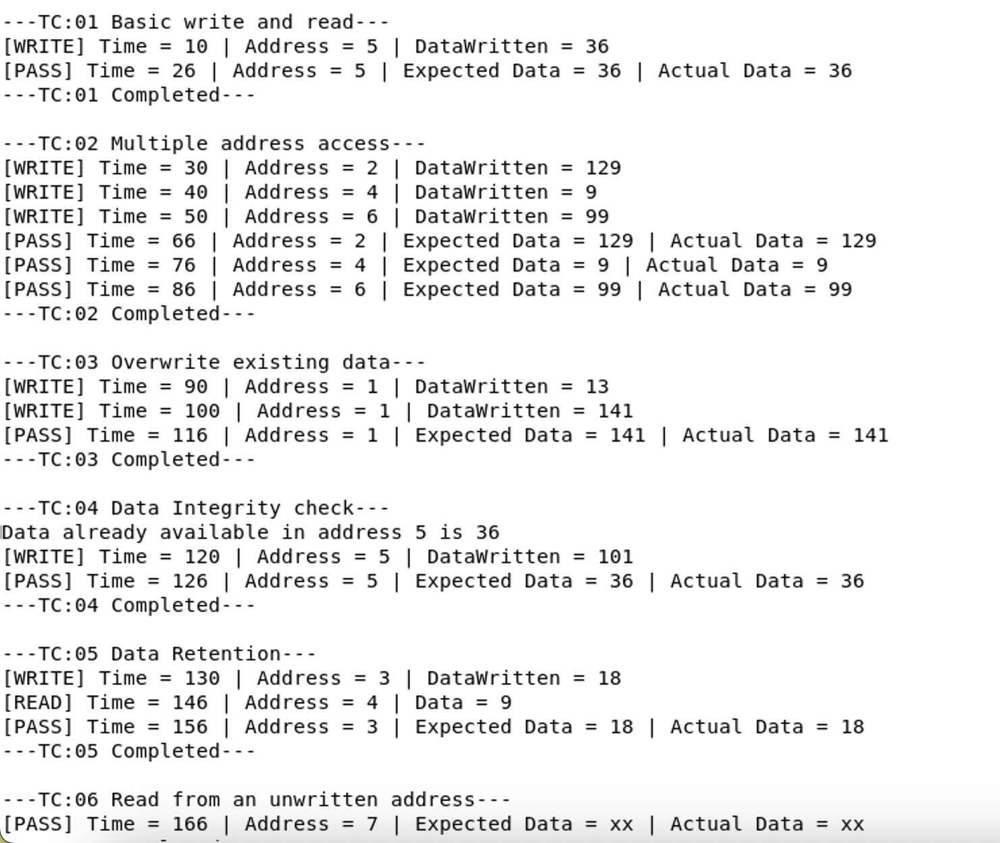
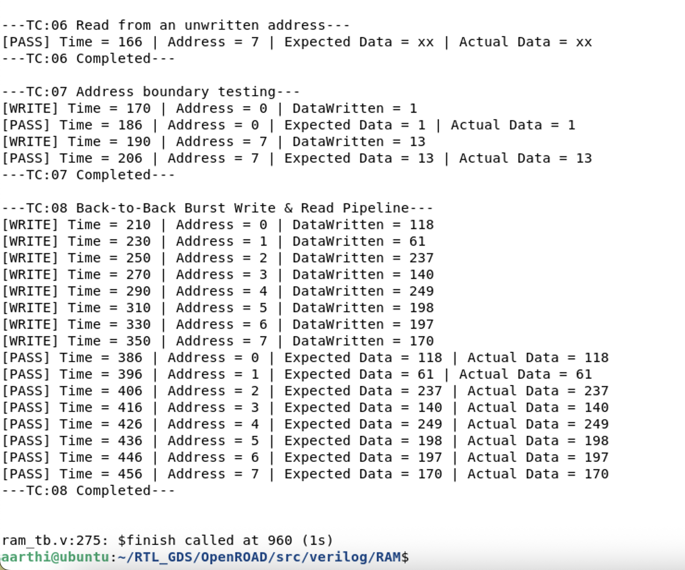
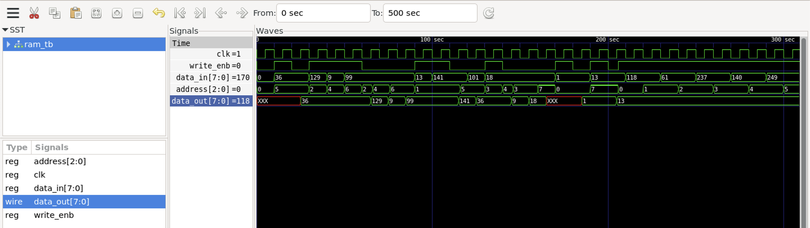
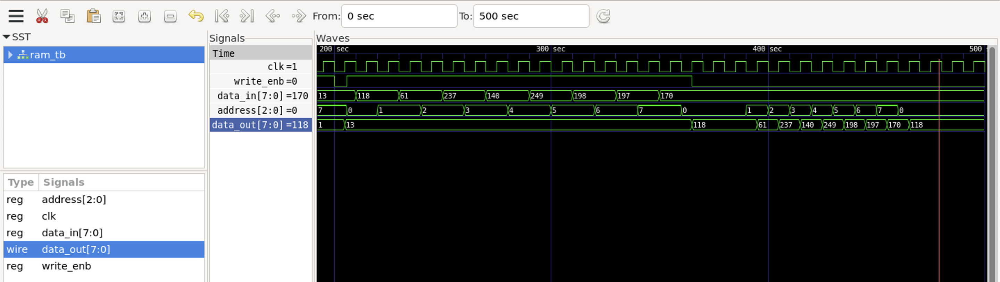

## 7. REPOSITORY STRUCTURE:
``` text
RAM/
├── rtl/
|    └── ram.v
├── testbench/
|    └── ram_tb.v
├── README.md
├── Images/ 
├── Output/ 
└── Waveform/
```
## 8. KEY LEARNINGS:
- Memory modeling using Verilog HDL
- Address-based data access
- Read/write control logic
---
