<h1 align = "center"> SYNCHRONOUS FIFO </h1>

## 1. PROJECT OVERVIEW:
This project implements a Synchronous First-In, First-Out (FIFO) buffer using Verilog HDL. A Synchronous FIFO is a data buffer in which data items are retrieved in the exact order in which they were stored. The term "Synchronous" means that both the write and read operations are synchronized to the same clock signal.

## 2. DESIGN SPECIFICATION:
| **Parameter** | **Description** |
|---|---|
| Data Width | 8 bits |
| FIFO Depth | 8 entries |
| Clock | Single clock |
| Status Flags | Full, Empty |
| Verification | Verilog testbench |
| Simulation Tools | Icarus Verilog, GTKWave |

## 3. ARCHITECTURE:
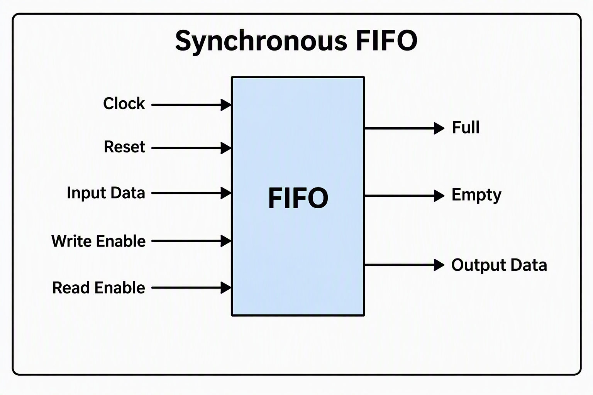
### Signal Description:
- **Input:** Clock(1 bit), Reset(1 bit), Input Data(8 bits), Write Enable(1 bit), Read Enable(1 bit)
- **Output:** Empty(1 bit - Status Flag), Full(1 bit - Status Flag), Output Data(8 bits)  

## 4. FUNCTIONAL DESCRIPTION:
- **Temporary Storage:** The FIFO acts as a sequential buffer to hold data temporarily
- **Write Operation:** When **Write Enable** is high (and the FIFO is not full), the input data is written into the memory array and the write pointer is incremented by one
- **Read Operation:** When **Read Enable** is high (and the FIFO is not empty), data is read from the memory array to the output and the read pointer is incremented by one
- **Status Flags:** 
  - `Empty` goes high when no data is available, blocking read operations to prevent underflow
  - `Full` goes high when maximum capacity is reached, blocking write operations to prevent overflow
- **Clock Synchronization:** Both read and write operations are fully synchronized to a single clock signal

## 5. VERIFICATION AND TEST CASES:
| TC No. | Test Case |
|---|---|
| TC1 | Reset |
| TC2 | Write one word |
| TC3 | Read one word |
| TC4 | Pointer wraparound |
| TC5 | Write 8 words |
| TC6 | Attempt a write when full |
| TC7 | Read 8 words |
| TC8 | Attempt a read when empty |
| TC9 | Write and read repeatedly |

## 6. SIMULATION RESULTS:
### TC1 - Reset : <span style="color:green">PASS</span>
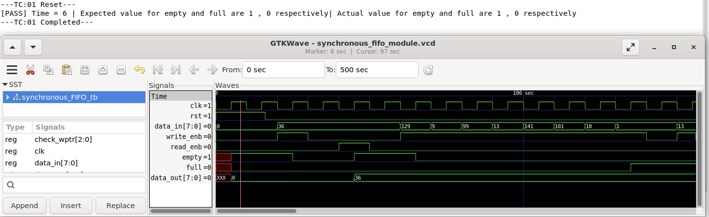
### TC2 - Write one word : <span style="color:green">PASS</span>
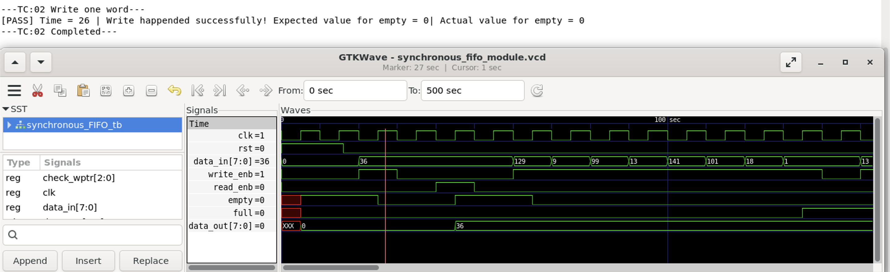
### TC3 - Read one word : <span style="color:green">PASS</span>
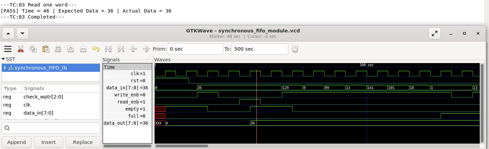
### TC4 - Pointer wraparound : <span style="color:green">PASS</span>
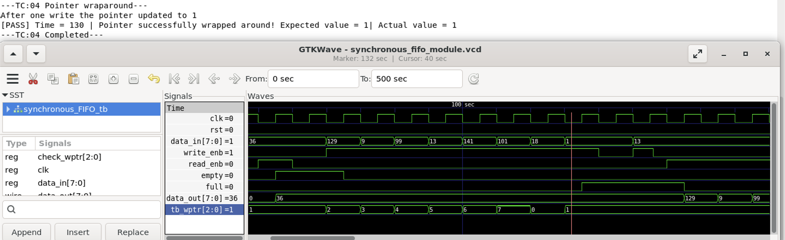
### TC5 - Write 8 words : <span style="color:green">PASS</span>
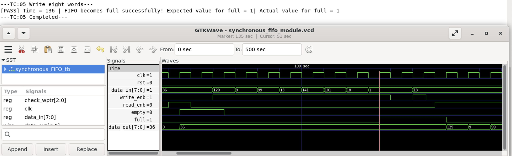
### TC6 - Attempt a write when full : <span style="color:green">PASS</span>
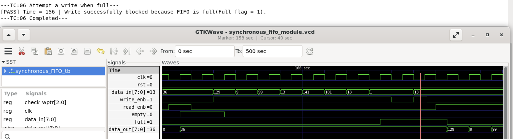
### TC7 - Read 8 words : <span style="color:green">PASS</span>
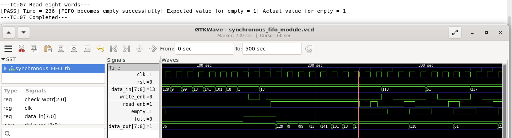
### TC8 - Attempt a read when empty : <span style="color:green">PASS</span>
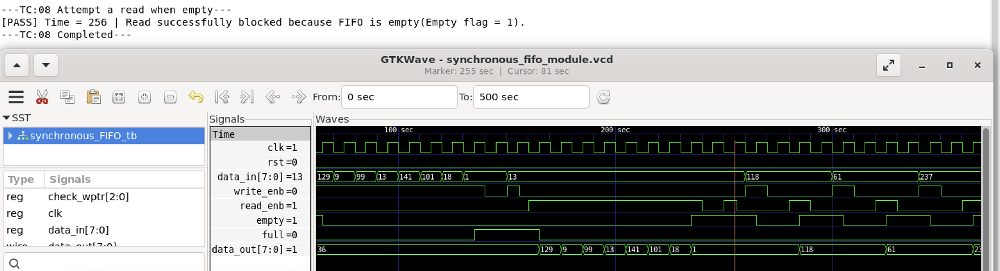
### TC9 - Write and read repeatedly : <span style="color:green">PASS</span>
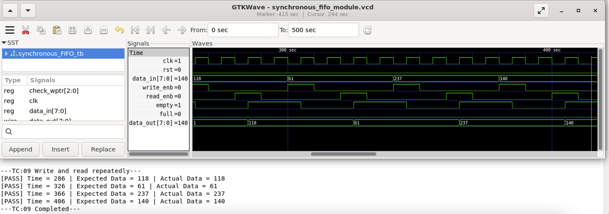

The below images depict the overall output and waveform generated after running the testbench for Synchronous FIFO module.
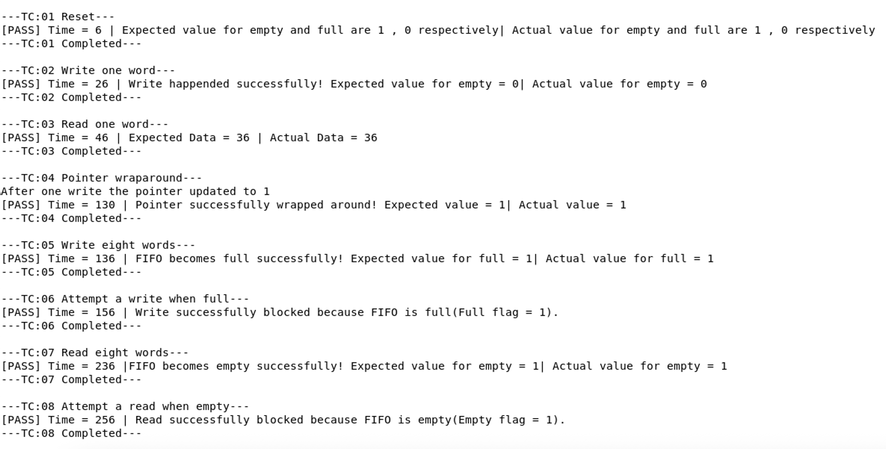
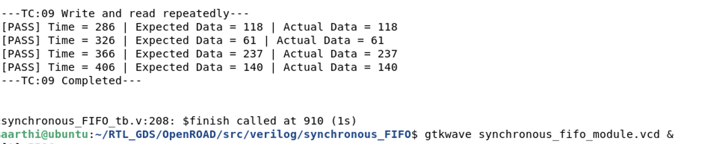
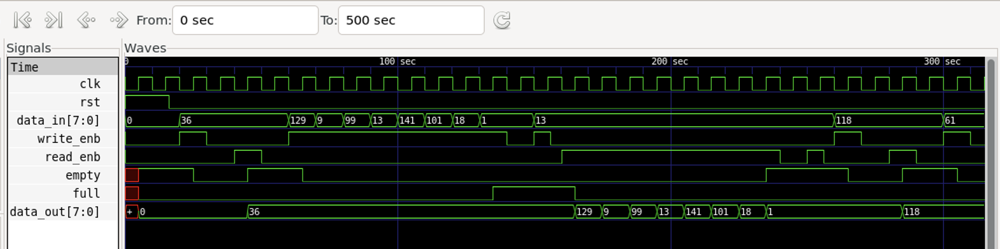
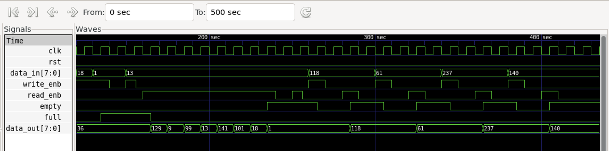


## 7. REPOSITORY STRUCTURE:
``` text
Synchronous_FIFO/
├── rtl/
|    └── synchronous_fifo.v
├── testbench/
|    └── synchronous_fifo_tb.v
├── README.md
├── Images/ 
├── Output/ 
└── Waveform/
```
## 8. KEY LEARNINGS:
- FIFO architecture and buffering
- Pointer and occupancy management
- Control flag generation
- Boundary-condition verification
---
