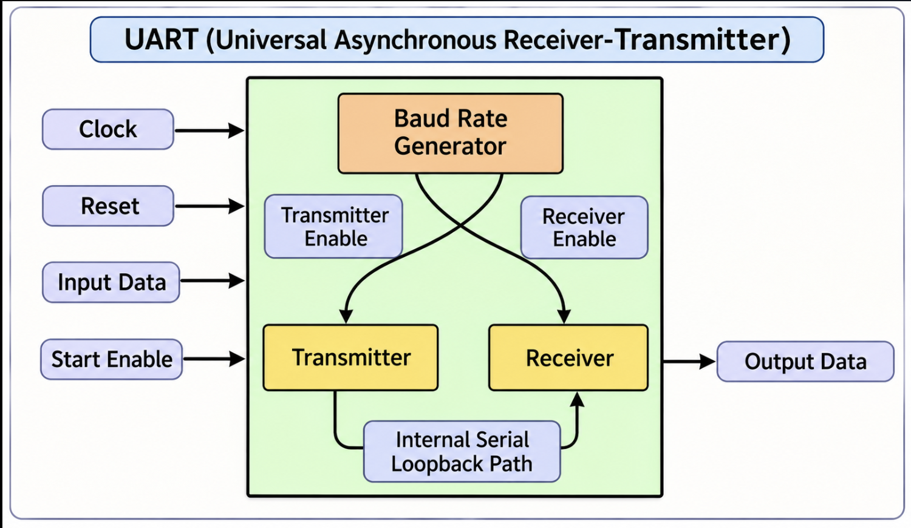
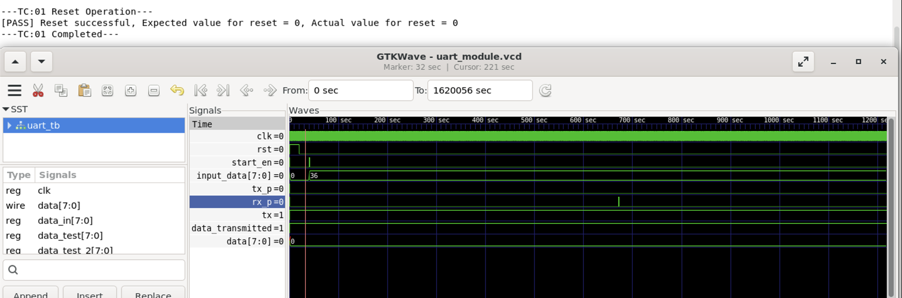
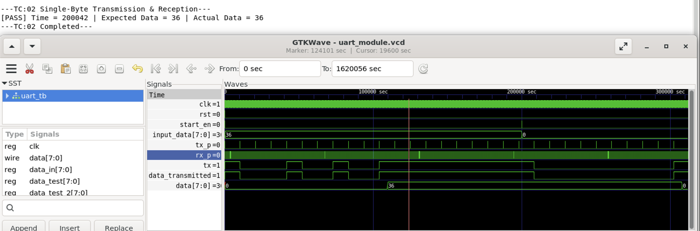
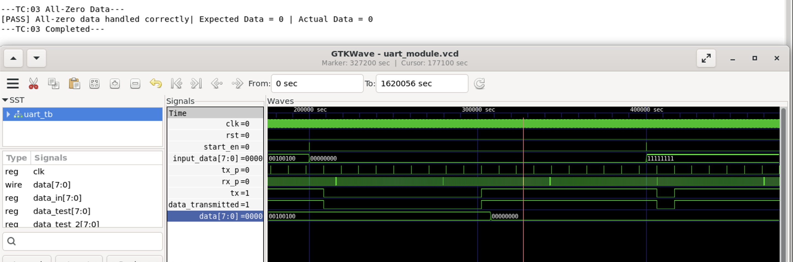
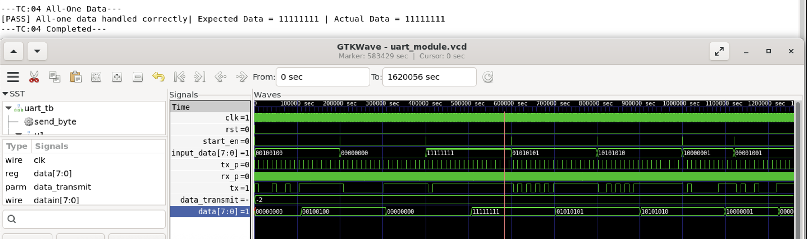
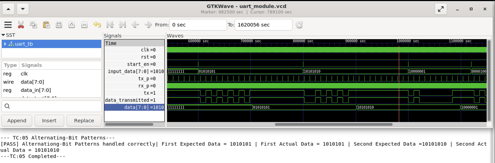
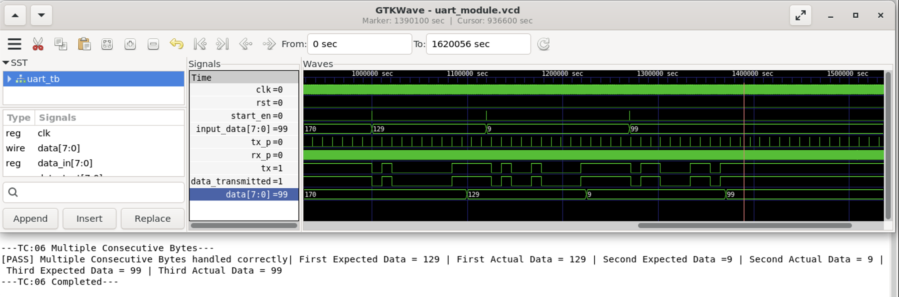
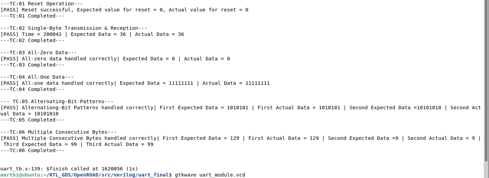
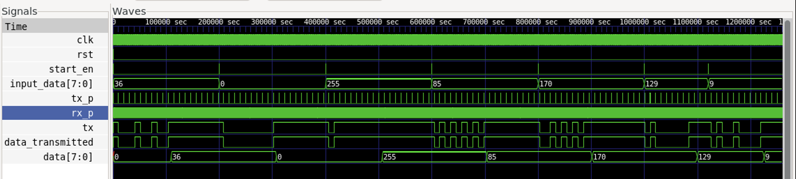
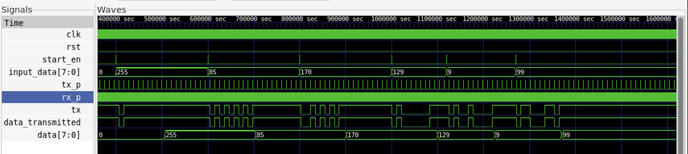

<h1 align = "center"> UNIVERSAL ASYNCHRONOUS RECEIVER TRANSMITTER </h1>

## 1. PROJECT OVERVIEW:
This project implements an Universal Asynchronous Receiver Transmitter(UART) using Verilog HDL. It supports asynchronous serial data transmission and reception between communicating devices.

## 2. DESIGN SPECIFICATION:
| **Parameter** | **Description** |
|---|---|
| Data Width | 8 bits |
| Communication| Serial, asynchronous|
| Frame Format| Start bit, 8 data bits, Stop bit |
| Baud Rate | 9600 bits/sec |
| Verification | Verilog testbench |
| Simulation Tools | Icarus Verilog, GTKWave |

## 3. ARCHITECTURE:


### Signal Description:
- **Top-Level Module (UART)**:
  + **Input:** Clock(1 bit), Reset(1 bit), Input Data(8 bits), Start Enable(1 bit)
  + **Output:** Output Data(8 bits)  

- **Baud Rate Generator:**
  + **Input:** Clock(1 bit), Reset(1 bit)
  + **Output:** Transmitter Enable(1 bit), Receiver Enable(1 bit)

- **Transmitter:**
  + **Input:** Clock(1 bit), Reset(1 bit), Transmitter Enable(1 bit), Start Enable(1 bit), Input Data(8 bits)
  + **Output:** Transmitted Data(1 bit)

- **Receiver:**
  + **Input:** Clock(1 bit), Reset(1 bit), Receiver Enable(1 bit), Received Data(1 bit)
  + **Output:** Output Data(8 bits)

## 4. MODULE DESCRIPTION:
- **Baud Rate Generator:**
  + The baud rate is configured to **9600 bits/sec** with a clock frequency of **50 MHz**
  + The "Transmitter Enable" signal is generated once every 5209 clock cycles, providing the timing required to transmit one serial bit.
  + The "Receiver Enable" signal is generated once every 326 clock cycles, providing the timing required to receive one serial bit.

- **Transmitter:**
  + Converts the parallel input data into a serial bit stream
  + The transmitter uses a **Finite State Machine (FSM)** to control the transmission sequence.
  + When **Transmitter Enable** is high, FSM will be moved from start state to **Data Transmit** state
  + In the Data Transmit state, single bit data will be transmitted and once all the bits are transmitted, it will be moved to the **Stop** state


- **Receiver:**
  + Receives a serial bit stream and converts it into parallel data
  + The receiver uses a **Finite State Machine (FSM)** to control the reception sequence.
  + When **Receiver Enable** is high, FSM will be moved from start state to **Received** state
  + In the Received state, single bit data will be received and once all the bits are received, it will be moved to the **Stop** state

## 5. FUNCTIONAL DESCRIPTION:
  + **Transmission:** The transmitter accepts parallel data and a transmit-enable signal. The input data is converted to serial bit stream
  + **Data Frame:** Each UART frame consists of a start bit, 8 data bits, and a stop bit. The start bit indicates the beginning of a frame, and the stop bit indicates its completion
  + **Reception:** The receiver detects the incoming start bit and samples the serial data. The received bits are assembled into a parallel data word

## 6. VERIFICATION AND TEST CASES:
| TC No. | Test Case |
|---|---|
| TC1 | Reset operation |
| TC2 | Single-Byte Transmission & Reception |
| TC3 | All-Zero Data |
| TC4 | All-One Data |
| TC5 | Alternating-Bit Patterns |
| TC6 | Multiple Consecutive Bytes |

## 7. SIMULATION RESULTS:
### TC1 - Reset operation : <span style="color:green">PASS</span>

### TC2 - Single-Byte Transmission & Reception : <span style="color:green">PASS</span>

### TC3 - All-Zero Data : <span style="color:green">PASS</span>

### TC4 - All-One Data : <span style="color:green">PASS</span>

### TC5 - Alternating-Bit Patterns : <span style="color:green">PASS</span>

### TC6 - Multiple Consecutive Bytes : <span style="color:green">PASS</span>


The below images depict the overall output and waveform generated after running the testbench for UART module.




## 8. REPOSITORY STRUCTURE:
``` text
UART/
├── rtl/
     └── uart_top.v
     └── baudrategenerator.v
     └── receiver.v
     └── transmitter.v
├── testbench/
|    └── uart_tb.v
├── README.md
├── Images/ 
├── Output/ 
└── Waveform/
```
## 9. KEY LEARNINGS:
- UART serial communication
- FSM-based RTL design
- Serial-to-parallel and parallel-to-serial conversion
---
